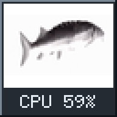

# wmfishcpu

A 64 × 64 Linux dockapp for Window Maker on X11. A spinning fish doubles as a CPU meter: it stays still at **0%**, spins at half speed at **50%**, and reaches full speed at **100%**. The tile also shows total CPU usage across all cores and updates its reading twice a second.



## Build and run

You'll need a C compiler, Make, the Xlib and zlib development headers, Python 3, FFmpeg, and curl (for downloading the clip).

- Fedora: `sudo dnf install gcc make libX11-devel zlib-devel python3 ffmpeg-free curl`
- Debian/Ubuntu: `sudo apt install build-essential libx11-dev zlib1g-dev python3 ffmpeg curl`

From the project directory:

```sh
make fetch-video
make
./wmfishcpu
```

The first command fetches the referenced fish clip from Reddit. If the link stops working or you want to use your own clip, run `make clean && make VIDEO=/path/to/animation.mp4` instead. The build embeds the frames in the executable, which runs offline without FFmpeg or Python.

Drag the tile into the Window Maker Dock or Clip to pin it. If desired, `make install` installs the executable in `~/.local/bin`. Use `make check` to check the CPU calculations and embedded frames.

```sh
./wmfishcpu --max-speed 5        # Set the maximum to 5× the clip speed (default: 3×)
./wmfishcpu --window             # Show a regular X11 window
./wmfishcpu --window --cpu 100   # Preview full speed without stressing the CPU
./wmfishcpu --help
```

## Credits and AI disclosure

- **Project idea and requirements:** [@thebuyan](https://github.com/thebuyan) requested a spinning-fish CPU monitor for Window Maker, specified how CPU usage should control the speed, and supplied the animation reference.
- **AI implementation:** [OpenAI Codex](https://openai.com/codex/) wrote the C/X11 app, frame conversion and build tools, and this documentation. Codex also ran the build and checked the animation behavior. This project was built with AI from the user's brief.
- **Fish animation:** [Reference clip hosted on Reddit](https://preview.redd.it/llj65a3b50ja1.gif?width=640&format=mp4&s=531009aaed79a173f412e75b181e16b646b4b3d6). The original creator has not been verified. The animation was supplied as a reference and was not created by the project or by Codex. The repository shows a screenshot of the running dockapp. The source video and playback assets are not bundled.
- **Dock integration reference:** [Window Maker's dockapp examples](https://github.com/window-maker/dockapps/tree/master/wmmemload).
